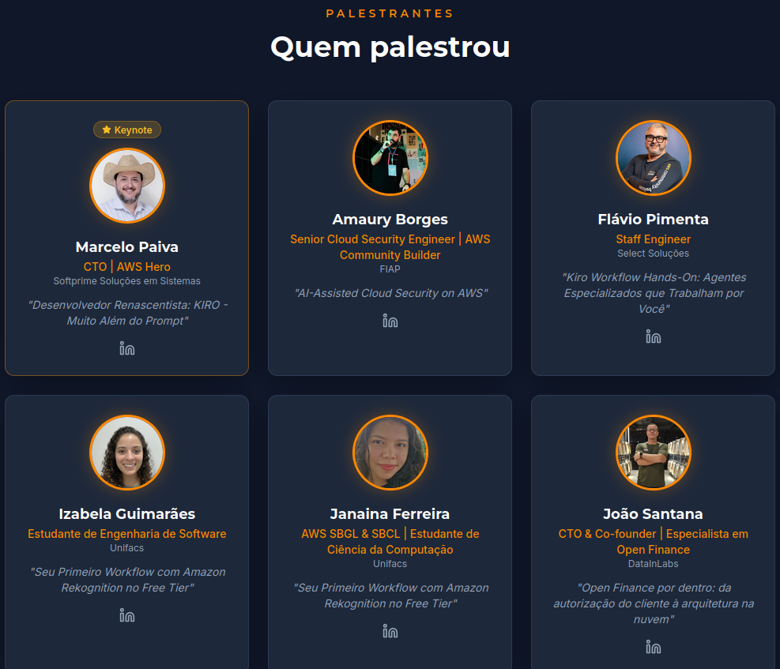

# AWS Community Day Brasil 2026 — Salvador 🇧🇷 ☁️

This repository documents my participation as a speaker at
**AWS Community Day Brasil 2026 — Northeast Edition**, held in
Salvador, Bahia, Brazil.

The event brought together AWS professionals, community leaders,
developers, and cloud enthusiasts to share knowledge, technical
experiences, and innovations across the AWS ecosystem.

## Event Details

- **Event:** AWS Community Day Brasil 2026 — Northeast Edition
- **Date:** October 10, 2026
- **Location:** Universidade SENAI CIMATEC — Salvador, Brazil
- **Format:** In-person
- **Community:** AWS User Group Salvador
- **Official Website:** [AWS Community Day Brasil](https://awscommunityday.com.br/nordeste/)

## My Session

### AI-Assisted Cloud Security on AWS

**Speaker:** Amaury Borges  
**Role:** Senior Cloud Security Engineer | AWS Community Builder  
**Stage:** Main Stage  
**Time:** 09:00 – 10:00

### Session Overview

Exploring how Artificial Intelligence can support modern Cloud
Security operations on AWS.

The session focuses on connecting AWS security services,
automation, and AI-assisted workflows to improve security
analysis, risk prioritization, and operational efficiency.

### 🔐 Main Topics

- AWS Cloud Security
- AI-Assisted Security Analysis
- Security Findings & Risk Prioritization
- Security Automation
- AI Agents & Security Guardrails
- Human-in-the-Loop Security

## 🚀 Event Highlights

The event featured technical sessions covering:

- ☁️ AWS Architecture & Cloud Computing
- 🔐 Cloud Security & Automation
- 🤖 Artificial Intelligence & Machine Learning
- ⚙️ Terraform & Infrastructure as Code
- 📊 Observability
- 🏗️ Platform Engineering
- 🌎 AWS Community & Networking

## 🔗 Session Resources

- 🌐 [Official Event Website](https://awscommunityday.com.br/nordeste/)
- 🎤 [Presentation Slides](YOUR_SPEAKERDECK_LINK)
- 💻 [GitHub Demo](YOUR_DEMO_LINK)
- 💼 [LinkedIn Post](YOUR_LINKEDIN_POST)

## 📸 Event Gallery

Photos and highlights from my participation at AWS Community Day
Brasil 2026 in Salvador.

### Speaking Session

### Event & Community

## 💡 Key Message

> AI doesn't replace Cloud Security controls.
> It helps security teams understand, prioritize,
> and respond to risks more effectively.

## 🌎 Community

AWS Community Days are community-led events focused on
knowledge sharing, technical collaboration, and networking.

It was a great opportunity to contribute to the AWS community
and share practical experiences around Cloud Security,
Artificial Intelligence, and security automation.

---

**#AWSCommunityDay #AWS #CloudSecurity #AISecurity #DevSecOps #AWSCommunity**